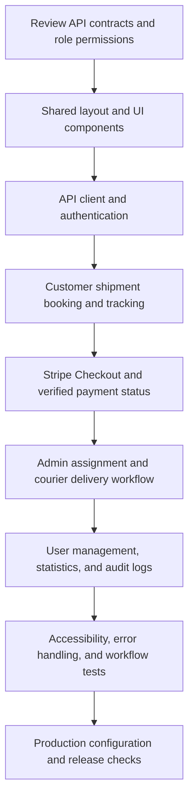
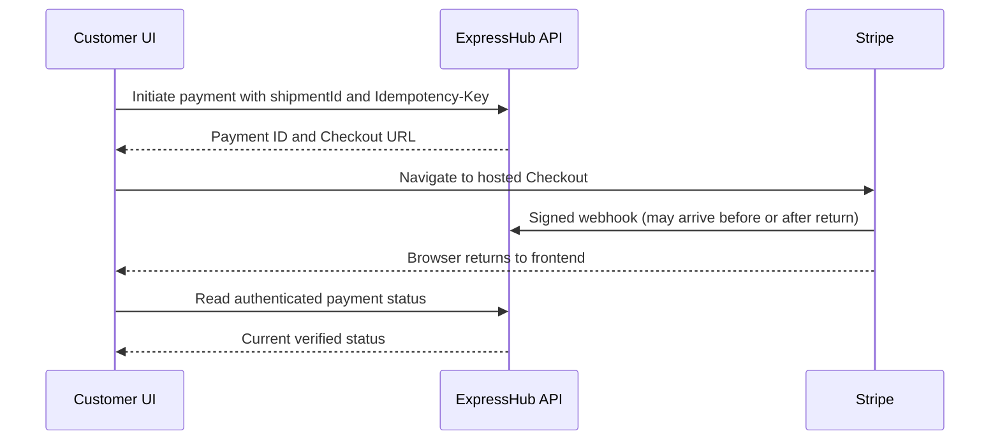

# ExpressHub Frontend Implementation Flow

## 1. Purpose and scope

Build a responsive frontend for ExpressHub's courier and logistics workflows, using [project_requirements.md](project_requirements.md) as the requirements baseline and the existing API as the integration contract.

The assignment explicitly says a frontend is not required. This document plans the requested frontend extension; it does not replace the backend requirements, including 20+ meaningful APIs, server-side authorization, real payment integration, audit logging, and soft deletion.

The requirements mention Express.js, while this repository implements its backend with Next.js Route Handlers. Extend the existing Next.js application without introducing a second backend. Use the existing `CUSTOMER`, `COURIER`, and `ADMIN` roles and Stripe Checkout integration.

**Contract references:** [OpenAPI](docs/openapi.json), [README](README.md), [validators](validators), [shipment service](services/shipment.service.ts), and [backend implementation flow](IMPLEMENTATION_FLOW.md). The routes below are proposed frontend routes; API mappings refer to implemented endpoints.

## 2. Implementation order



Complete a working customer booking-to-payment path before expanding administration. Add courier assignment before testing the full delivery path.

## 3. Screens and permissions

| Area | Proposed frontend routes | Main capabilities |
|---|---|---|
| Public | `/`, `/login`, `/register` | Service introduction, sign in, customer registration |
| Shared authenticated | `/profile` | View and edit own name, email, and phone; logout |
| Customer | `/customer`, `/customer/shipments`, `/customer/shipments/new` | Recent shipments, search/filter lists, shipment booking |
| Customer detail | `/customer/shipments/[id]` | Shipment information, event history, payment action, eligible cancellation |
| Customer payments | `/customer/payments`, `/customer/payments/[id]` | Own payment history and verified payment details |
| Checkout return | `/checkout/success`, `/checkout/cancel` | Restore session, retrieve payment status, explain next steps |
| Courier | `/courier`, `/courier/shipments`, `/courier/shipments/[id]` | Assigned shipments, delivery details, allowed status updates |
| Admin shipments | `/admin/shipments`, `/admin/shipments/[id]` | All visible shipments, courier assignment, operational status actions, eligible archival |
| Admin users | `/admin/users`, `/admin/users/[id]` | User lookup, role changes, activation/deactivation, eligible archival |
| Admin overview | `/admin`, `/admin/audit-logs` | Backend statistics and searchable audit history |

- Public registration creates Customers only; do not offer a privileged-role selector.
- Customers see their own records; Couriers see assigned shipments; Admins use administrative endpoints.
- Navigation and action visibility improve usability. The API must remain the authority for permissions and ownership, including requests made directly without the UI.
- Tracking is authenticated shipment detail/history in the initial release. A public tracking-number lookup requires an additional privacy-safe API.
- Do not show global customer/courier statistics calculated from one paginated page. Label summaries as recent items or use supported totals.

## 4. Phase 1 — Foundation and shared UI

### Tasks

- [ ] Review request bodies, response shapes, pagination metadata, filters, and role restrictions in the API documentation and validators.
- [ ] Follow the installed Next.js guides in `node_modules/next/dist/docs/` before implementation, especially layouts/pages and Server/Client Components.
- [ ] Use the existing Next.js, React, and TypeScript setup. Start with CSS or CSS Modules; verify any styling dependency before adopting it.
- [ ] Define consistent colors, spacing, typography, focus styles, and shipment/payment status badges.
- [ ] Build reusable buttons, labeled inputs, selects, cards, tables, mobile list cards, dialogs, pagination, loading states, empty states, and error notices.
- [ ] Create public and authenticated layouts with role-specific navigation and a mobile menu.
- [ ] Use Server Components for static structure and Client Components for interactive forms, session state, and authenticated browser API calls.

### Suggested organization

```text
app/
  (public)/              # Home, login, registration
  (dashboard)/           # Shared authenticated layout
    customer/
    courier/
    admin/
    profile/
  checkout/              # Payment return screens
  api/                   # Existing backend routes
components/
  ui/                    # Reusable controls and feedback
  layout/                # Header, navigation, dashboard shell
features/
  auth/
  shipments/
  payments/
  users/
  admin/
lib/
  client/                # Browser API client and safe formatting helpers
types/
  api.ts                 # Browser-safe API response types
```

Route groups do not add URL segments. Keep one page per URL and retain the root layout. Do not import Prisma, token-signing code, or server-only services into client bundles.

**Exit condition:** All planned page shells are reachable, responsive, and have shared loading, empty, and error presentations.

## 5. Phase 2 — API client and authentication

### API client

- [ ] Use `/api/v1` as the same-origin base path.
- [ ] Support the existing `{ success, message, data }` and `{ success, message, errors }` envelopes; preserve HTTP status and structured error information.
- [ ] Send JSON request bodies and Bearer access tokens for protected APIs.
- [ ] Centralize query serialization, cancellation of stale list requests, error mapping, and session expiry behavior.
- [ ] Handle `401` with one coordinated refresh and at most one retry. Exclude login/refresh failures from recursive retries; clear session state when refresh fails.
- [ ] Handle `403`, `404`, `409`, validation errors, `429`, network errors, and service failures with useful recovery actions. Honor retry timing when supplied.

### Session flow

1. Register or log in through the existing auth API.
2. Keep the access token in memory. Let the browser retain the backend's HttpOnly refresh cookie; do not store authentication tokens in local storage.
3. On reload, call refresh with cookie credentials, then load `/users/me` before showing protected content.
4. Redirect according to the server-returned role; validate any return URL as a local permitted destination.
5. On logout, revoke the refresh session through the API and clear in-memory state and private cached data.
6. Treat role changes, deactivation, and expired sessions as reasons to revalidate access and clear stale views.

Use the existing cookie and origin policy. Cross-origin deployment requires reviewing credentialed CORS and cookie settings together; same-origin deployment is the initial assumption.

### Screens

- [ ] Registration: name, email, password, optional phone; mirror server validation, including the password's 12-character minimum and 72-byte maximum.
- [ ] Login: email/password, submission progress, invalid-credentials feedback.
- [ ] Profile: prefilled current user fields, field errors, save confirmation.
- [ ] Authentication loading and access-denied views without protected-content flashes.

**Exit condition:** Each role lands in its own area, survives a reload through session restoration, and cannot access another role's data through the API.

## 6. Phase 3 — Customer shipment workflow

### Booking flow

`Shipment list → New shipment → Pickup details → Delivery details → Parcel details → Review → Create → Shipment detail → Pay`

- [ ] Collect pickup and delivery contact names, phones, and addresses.
- [ ] Collect positive parcel weight in kilograms, optional description, and optional dimensions in centimeters. Supply all three dimensions or omit them together.
- [ ] Support an optional future pickup date/time; convert user input to an ISO timestamp with an explicit timezone.
- [ ] Mirror field limits and numeric precision from `validators/shipment.ts`, while retaining server-side validation as authoritative.
- [ ] Submit only accepted fields. Display the price and currency returned by the server after creation; no quote endpoint currently exists.
- [ ] Prevent duplicate submissions while a request is pending. Do not blindly retry shipment creation after an ambiguous network failure; help the user check their shipment list first.

### Lists and detail

- [ ] Display tracking number, addresses or suitable summaries, shipment status, payment status, price, and creation date.
- [ ] Add pagination, debounced search, status/payment filters, date filters, and supported sorting. Keep filter state in URL query parameters and reset the page when filters change.
- [ ] Use server metadata for pagination; distinguish no shipments from no search results.
- [ ] Show shipment events returned by the detail endpoint in chronological order, respecting the API's role-specific field visibility.
- [ ] Offer cancellation only for an eligible `CREATED` shipment, using the status endpoint with `expectedStatus`.
- [ ] Explain cancellation conflicts such as a pending Checkout session. Do not imply that cancelling a shipment automatically refunds a payment.

**Exit condition:** A Customer can book, find, inspect, and request cancellation of an eligible own shipment using real API data.

## 7. Phase 4 — Stripe payment workflow



- [ ] Use `POST /payments/initiate`; preserve the same idempotency key for retries of the same attempt.
- [ ] Store a non-secret payment ID for return recovery. Do not persist tokens or infer settlement from return-query parameters.
- [ ] Navigate to the backend-returned Checkout URL; show progress and disable duplicate initiation.
- [ ] Implement success/cancel return pages, then configure `STRIPE_SUCCESS_URL` and `STRIPE_CANCEL_URL` to those pages. Existing return endpoints produce informational JSON, so configuration is an explicit integration step.
- [ ] Restore authentication after returning and fetch `/payments/:id`. If the local payment ID is missing, guide the user to authenticated payment history.
- [ ] Show pending verification until the API reports settlement. Use bounded polling with backoff, then offer manual refresh if verification is delayed.
- [ ] Display supported statuses: `PENDING`, `PAID`, `FAILED`, `REFUND_PENDING`, and `REFUNDED`.
- [ ] A cancelled browser return is not evidence of a failed or cancelled payment. Fetch the actual status before offering the next action.
- [ ] Start a fresh attempt only when the backend permits it; preserve idempotency behavior during retries and refreshes.
- [ ] Display amount and currency from API data without floating-point recalculation.

The browser never calls the webhook, sets a payment to paid, collects raw card details, or receives Stripe secret keys. Do not add Cash on Delivery, Pay Later, or manual paid-status controls.

**Exit condition:** A genuine Stripe test-mode Checkout is reflected by verified backend status, including delayed-webhook, cancellation, retry, and expired-session scenarios.

## 8. Phase 5 — Assignment and courier operations

### Admin assignment

- [ ] List active Couriers using the user-list role/status filters.
- [ ] Assign through `PATCH /shipments/:id/assign-courier`, sending both `courierId` and the current `expectedCourierId` (including `null` when unassigned).
- [ ] Reflect backend assignment eligibility; assignment is currently restricted to `CREATED` or `FAILED` shipments.
- [ ] On `409`, reload the record and explain the conflict before another submission.

### Courier delivery flow

`Assigned shipments → Shipment detail → Picked up → In transit → Out for delivery → Delivered or failed`

| Current status | Possible next status | UI rule |
|---|---|---|
| `CREATED` | `PICKED_UP`, `CANCELLED` | Courier can pick up; cancellation belongs to eligible Customer/Admin actions |
| `PICKED_UP` | `IN_TRANSIT` | Assigned Courier/Admin action |
| `IN_TRANSIT` | `OUT_FOR_DELIVERY` | Assigned Courier/Admin action |
| `OUT_FOR_DELIVERY` | `DELIVERED`, `FAILED` | Require confirmation or failure note |
| `FAILED` | `IN_TRANSIT`, `RETURNED` | Admin handles retry/return; require a return note |
| `DELIVERED`, `RETURNED`, `CANCELLED` | None | Terminal states; no further status action |

- [ ] Send `status`, `expectedStatus`, and any required `note` through the status API.
- [ ] Enforce visible prerequisites: confirmed payment and an active assigned Courier for pickup/dispatch transitions; let the server validate every operation.
- [ ] Keep customer cancellation separate from courier delivery controls.
- [ ] Display the server-confirmed result and reload shipment details/history after mutation. Do not optimistically confirm delivery.
- [ ] Support mobile operation with prominent actions, readable contact information, and accessible confirmation dialogs.

**Exit condition:** Admin assignment and a Courier's delivery path work end to end; stale updates and unauthorized transitions are rejected and recoverable.

## 9. Phase 6 — Administration

- [ ] Populate overview cards only from `/admin/dashboard-stats`; use returned fields rather than inventing analytics.
- [ ] Build user search, role/active filters, pagination, detail, role changes, and activation/deactivation.
- [ ] Require confirmation for privileged or destructive actions and show backend restriction errors clearly.
- [ ] Implement user and shipment archival with the required reason. Explain that archive is a soft delete and is distinct from shipment cancellation.
- [ ] Show shipment archive controls only for terminal records, subject to backend payment and permission checks.
- [ ] Build audit-log filtering and pagination from its supported contract; display actor, action, entity, and timestamp when provided.
- [ ] Link to individual payment details where IDs and permissions permit. Existing payment history is caller-scoped, including for Admins; it is not a global payment ledger.

**Exit condition:** Admins can manage users and operations, and critical actions appear in backend audit records.

## 10. Screen-to-API mapping

All paths in this table are relative to `/api/v1`. Alias endpoints need not produce duplicate screens.

| Frontend feature | Existing API |
|---|---|
| Register / login | `POST /auth/register`, `POST /auth/login` |
| Restore session / logout | `POST /auth/refresh-token`, `POST /auth/logout` |
| Profile | `GET /users/me`, `PATCH /users/me` |
| Book shipment | `POST /shipments` |
| Own / assigned shipment list | `GET /shipments/my-shipments` |
| Scoped search / filtering | `GET /shipments`, `GET /shipments/search` |
| Shipment detail and history | `GET /shipments/:id` |
| Cancel / delivery transition | `PATCH /shipments/:id/status` |
| Assign Courier | `PATCH /shipments/:id/assign-courier` |
| Archive shipment | `DELETE /shipments/:id` with reason body |
| Start Checkout | `POST /payments/initiate` |
| Own payment history / detail | `GET /payments`, `GET /payments/:id` |
| Admin shipment list | `GET /admin/shipments` |
| Admin user list / detail | `GET /users`, `GET /users/:id` |
| Change role / active state | `PATCH /users/:id/role`, `PATCH /users/:id/status` |
| Archive user | `DELETE /users/:id` with reason body |
| Admin statistics / audits | `GET /admin/dashboard-stats`, `GET /admin/audit-logs` |

The backend's minimum API count remains a backend requirement. Webhooks, health checks, and compatibility aliases do not require their own frontend pages.

## 11. Features requiring separate backend work

Do not build active controls for these until their contracts and authorization are implemented:

| Feature | Current gap |
|---|---|
| Google/social login, password reset | No corresponding flow in the documented auth endpoints |
| Public parcel tracking | No privacy-safe public tracking lookup endpoint |
| Edit booked shipment fields | No general shipment-edit endpoint |
| Pre-booking shipping quote | No standalone quote endpoint |
| Live location, maps, push updates | No location feed or realtime transport contract |
| Delivery image/signature upload | No supported upload/attachment endpoint |
| Hub and pricing management UI | Database models exist, but management APIs are not documented |
| Global payment ledger or refund action | No documented all-payments list or refund-initiation endpoint |
| Restore archived records | No restore endpoint |

## 12. Phase 7 — Verification and release

### Workflow acceptance checks

- [ ] Customer: register → reload session → book shipment → pay → verify paid status → view tracking/history.
- [ ] Courier: sign in → view assigned shipment → complete permitted transitions with required notes.
- [ ] Admin: assign Courier → manage user state/role → inspect audit logs → archive an eligible record.
- [ ] Authorization: test direct API requests for cross-customer access and incorrect roles, not just hidden buttons.
- [ ] Authentication: test expired access token, failed refresh, simultaneous requests, logout, and role/deactivation changes.
- [ ] Payments: test successful, abandoned, delayed, repeated, and failed Checkout attempts against Stripe test mode with signed webhook delivery.
- [ ] Concurrency: simulate two operators updating/assigning the same shipment; verify conflict recovery and no false success message.
- [ ] Lists/forms: test pagination, empty results, malformed fields, failed requests, `429`, and timezone formatting.
- [ ] Accessibility: keyboard navigation, visible focus, field labels, announced errors, focus management, and status text independent of color.
- [ ] Responsive behavior: booking, tables, dialogs, and delivery controls on mobile and desktop.

Add focused frontend interaction/end-to-end coverage for the workflows above when implementing them. Keep existing backend tests as regression coverage. Run `npm run typecheck`, `npm run build`, and the relevant existing auth, shipment, payment, admin, list, and soft-delete suites with their required services configured.

### Release checklist

- [ ] Configure frontend origin, allowed cookie origin/CORS, and Stripe return URLs together.
- [ ] Verify production environment configuration keeps database, JWT, Stripe, and Redis secrets server-side.
- [ ] Ensure pricing data and required backend services are available for booking and authentication.
- [ ] Confirm production webhook configuration and authenticated status retrieval.
- [ ] Verify private data is cleared on logout and never shared through public/static caching.
- [ ] Check direct URL navigation, reloads, not-found pages, and service-error recovery.
- [ ] Update README with frontend routes, setup instructions, and the demonstration workflow.

**Definition of done:** All three roles can complete their authorized workflows through the UI using the existing API, payments rely on verified provider events, and frontend behavior preserves the backend's validation, ownership, concurrency, soft-delete, and audit guarantees.
