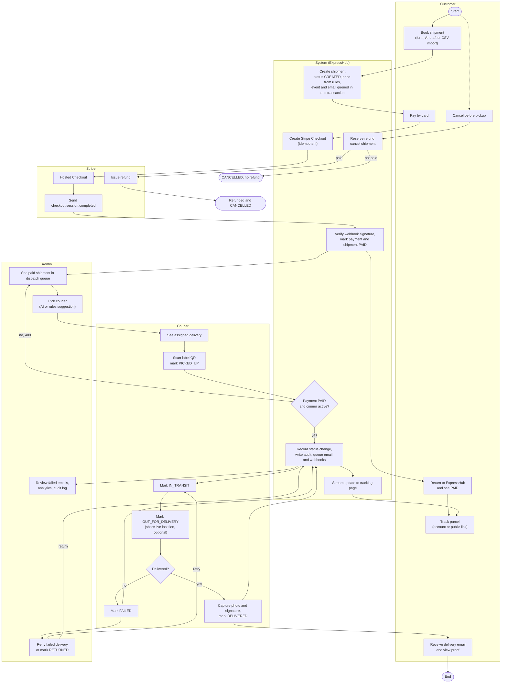

# Process flow: swimlane

End-to-end life of a parcel, from booking to delivery, with cancellation and refund.
Lanes are Customer, Admin, Courier, System (ExpressHub) and Stripe.
Mermaid has no native swimlane type, so each lane is a `subgraph` and arrows cross between them.
Status names and rules come from `services/shipment.service.ts:20` and `services/payment.service.ts`.

## Main flow

## Status lifecycle

Only these moves are allowed.
Each request must also send the status it believes is current, and a mismatch gives 409.

```mermaid
stateDiagram-v2
  [*] --> CREATED
  CREATED --> PICKED_UP: courier or admin, payment PAID
  CREATED --> CANCELLED: customer (own) or admin, refund if paid
  PICKED_UP --> IN_TRANSIT
  IN_TRANSIT --> OUT_FOR_DELIVERY
  OUT_FOR_DELIVERY --> DELIVERED: proof required
  OUT_FOR_DELIVERY --> FAILED
  FAILED --> IN_TRANSIT: admin retry
  FAILED --> RETURNED: admin
  DELIVERED --> [*]
  RETURNED --> [*]
  CANCELLED --> [*]
```

## Who does what

| Step | Customer | Admin | Courier | System | Stripe |
|---|---|---|---|---|---|
| Book | Starts | | | Creates shipment | |
| Pay | Pays | | | Creates session, confirms from webhook | Hosts Checkout, sends event |
| Assign | | Chooses courier | | Validates courier is active | |
| Pickup to delivery | Watches | Monitors | Moves status | Records, audits, notifies | |
| Proof | Views | Views | Uploads | Validates, strips metadata, locks after delivery | |
| Failure | | Retries or returns | Marks FAILED | Records | |
| Cancel | Before pickup | Before pickup (status CREATED) | Not allowed | Reserves refund, cancels | Refunds |
| Email | Receives | Retries or dismisses failures | | Outbox sends | |
