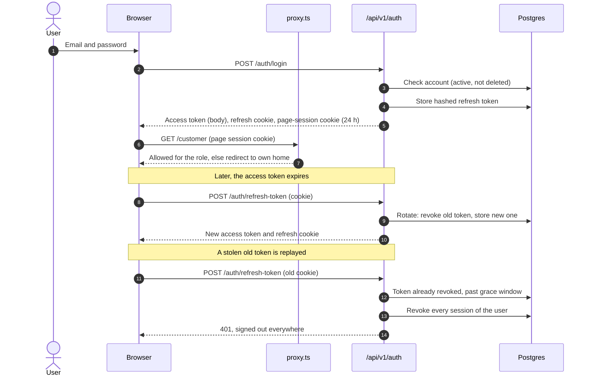
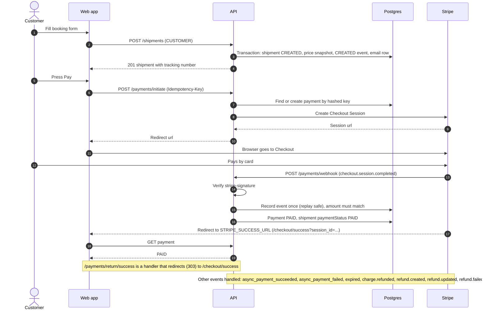
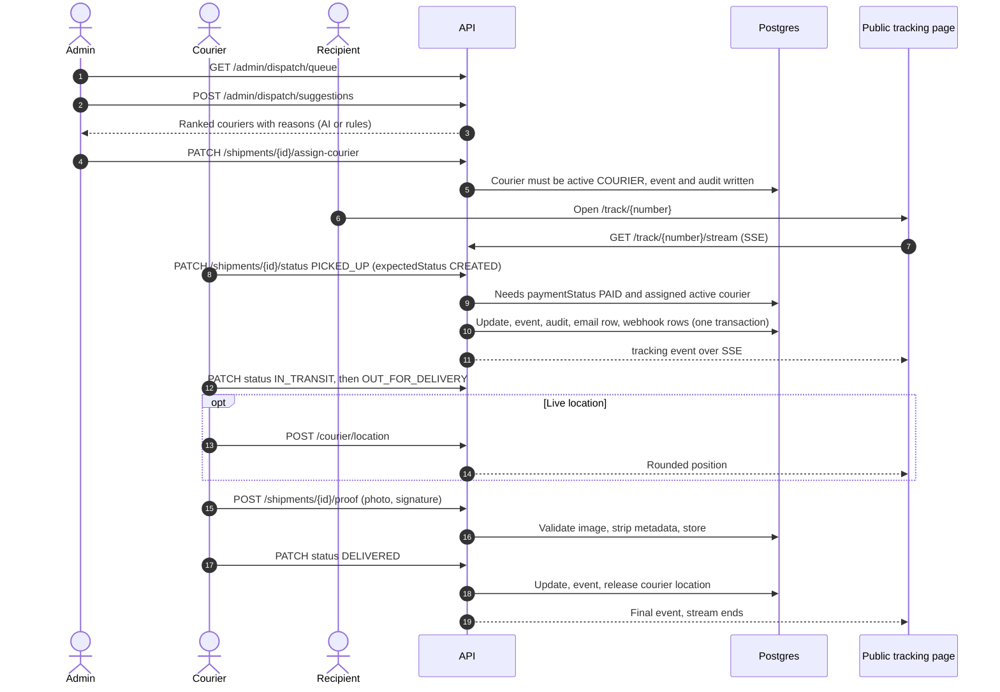
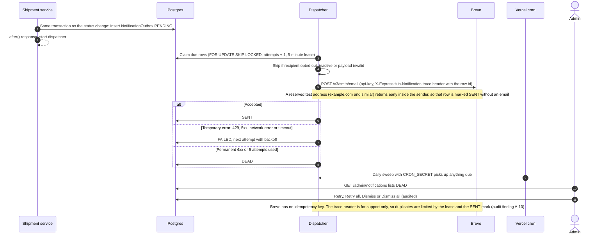
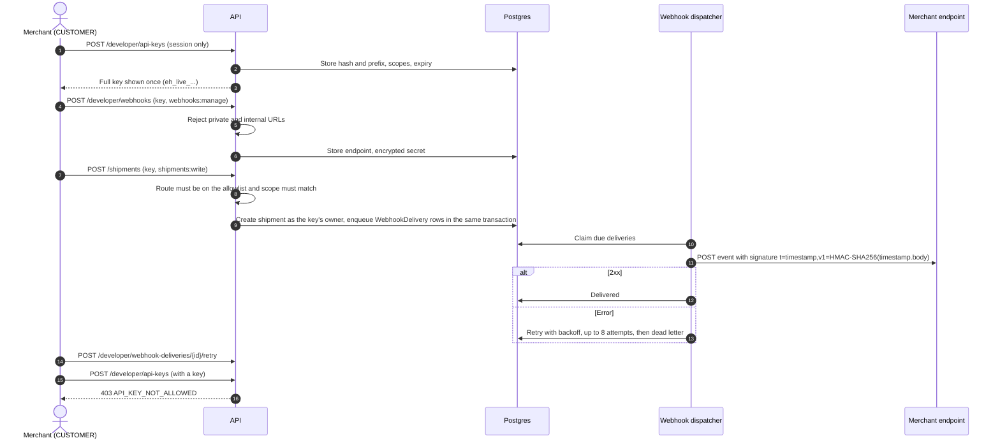
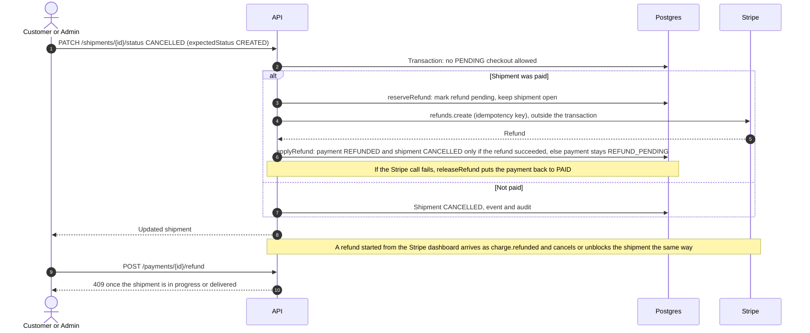

# Sequence diagrams

Six flows, each drawn from the code named under it.
Participants use the real route paths and service names.
Retry numbers are the constants in the code: email backoff roughly 1, 2, 4 and 8 minutes with 5 attempts, merchant webhooks 8 attempts.

## 1. Sign-in, refresh and reuse detection

Source: `services/auth.service.ts`, `lib/auth/require-user.ts`, `proxy.ts`.

## 2. Book and pay

Source: `services/shipment.service.ts` (`createShipment`), `services/payment.service.ts` (`initiatePayment`, `processStripeEvent`), `app/api/v1/payments/webhook`.

## 3. Assign, deliver and prove

Source: `assignCourier` and `updateShipmentStatus` in `shipment.service.ts`, `services/proof.service.ts`, `services/tracking-stream.ts`.

## 4. Email outbox

Source: `services/notifications/outbox.ts`, `dispatch.ts`, `sender.ts`, `app/api/v1/internal/notifications/dispatch`.

## 5. Merchant API and signed webhooks

Source: `lib/auth/require-user.ts`, `lib/merchant/api-keys.ts`, `services/developer.service.ts`, `services/webhooks/*`.

## 6. Cancel and refund

Source: `updateShipmentStatus`, `reserveRefund`, `sendRefund`, `applyRefund`, `initiateRefund` in the services.

